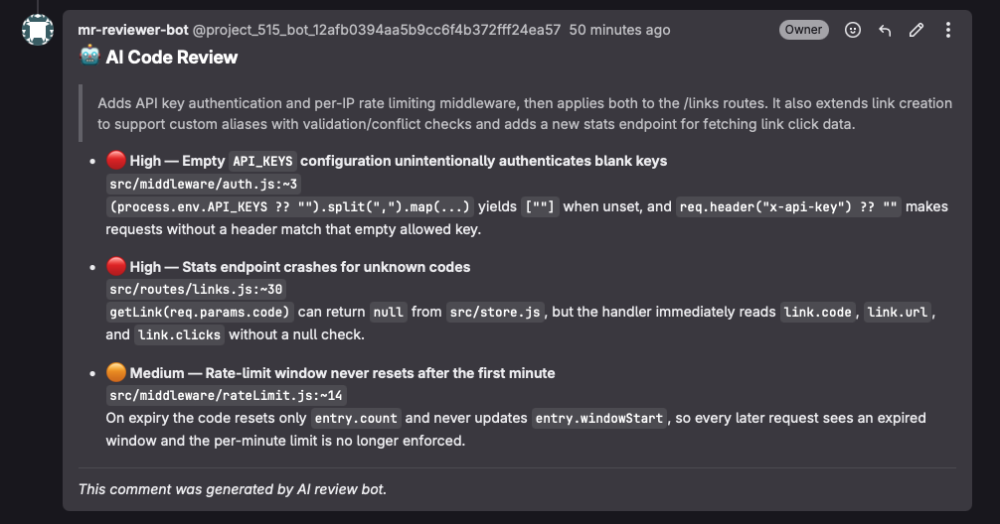
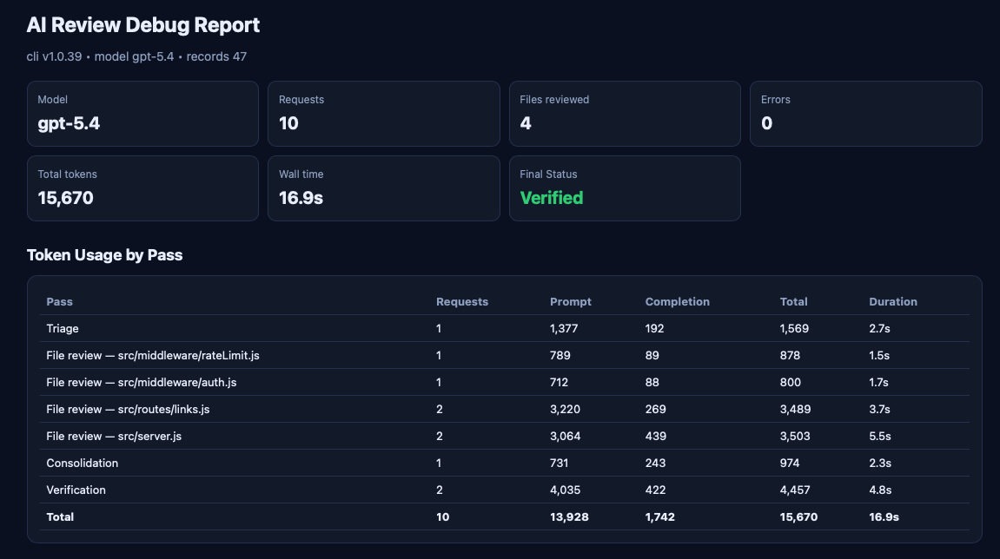
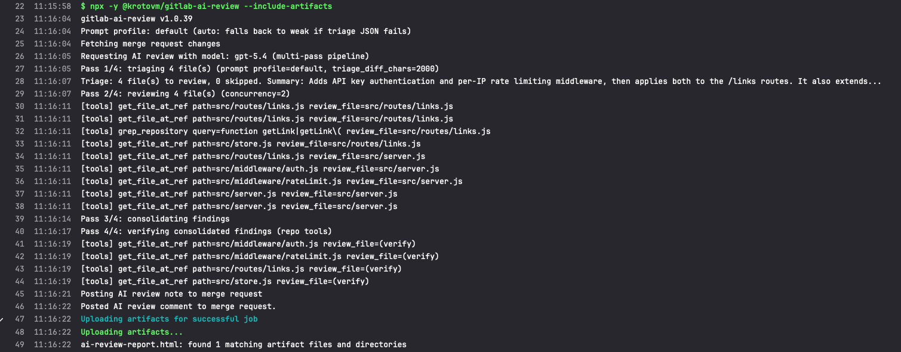

<!-- @format -->

# AI Code Reviewer

[](https://www.npmjs.com/package/@krotovm/gitlab-ai-review)
[](https://www.npmjs.com/package/@krotovm/gitlab-ai-review)
[](https://github.com/KrotovM/gitlab-ai-mr-reviewer/blob/main/LICENSE)
[](https://gitlab.com/explore/catalog/KrotovM/gitlab-ai-review)

Gitlab AI Code Review is a CLI tool that leverages OpenAI or Anthropic (Claude) models to automatically review code changes and post a Markdown review to GitLab merge requests from CI.

> **Benchmark:** on an AI-generated merge request (36 files, 5 seeded defects, three of them contradicting the MR description), gitlab-ai-review v1.0.49 found **5/5 with zero noise** on gpt-5.4, Claude Opus 5.5 and a self-hosted model; OpenCodeReview found 2–4/5 with 3–12 extra comments. [Details and methodology](#benchmark)



## Features

- Automatically reviews code changes in GitLab repositories
- Provides feedback on bugs and optimization opportunities
- Generates Markdown-formatted responses for easy readability in GitLab as merge request comment
- Follows your project's review rules from [`REVIEW.md`](#review-rules-reviewmd)

## Usage

### GitLab CI/CD

Run the tool in Merge Request pipelines to post an AI review comment to the MR. Later pipelines update that same comment instead of adding a new one on every push (GitLab marks it as edited); if it can't be found or edited, a new comment is posted.

Minimal MR review job:

```yaml
stages: [review]

ai_review:
  stage: review
  image: node:24
  rules:
    - if: '$CI_PIPELINE_SOURCE == "merge_request_event"'
  script:
    - npx -y @krotovm/gitlab-ai-review
```

Or include it as a [CI/CD component from the GitLab Catalog](https://gitlab.com/explore/catalog/KrotovM/gitlab-ai-review) (gitlab.com):

```yaml
include:
  - component: gitlab.com/KrotovM/gitlab-ai-review/review@1.0.3
    inputs:
      args: "--include-artifacts"
```

Save debug HTML as a CI artifact:

```yaml
stages: [review]

ai_review:
  stage: review
  image: node:24
  rules:
    - if: '$CI_PIPELINE_SOURCE == "merge_request_event"'
  script:
    - npx -y @krotovm/gitlab-ai-review --include-artifacts
  artifacts:
    expire_in: 7 days
    paths:
      - ai-review-report.html
```

The HTML artifact breaks the run down per pass — tokens, durations, triage decisions, per-file findings, and errors:



## Env variables

Set these in your project/group CI settings:

- `AI_PROVIDER` (optional, default: `openai`; one of `openai` \| `anthropic`)
- `OPENAI_API_KEY` (required for `openai`)
- `OPENAI_BASE_URL` (optional, for OpenAI-compatible providers/proxies)
- `ANTHROPIC_API_KEY` (required for `anthropic`)
- `AI_MODEL` (optional, default: `gpt-4o-mini` for `openai`, `claude-opus-5-5` for `anthropic`; examples: `gpt-4o`, `claude-sonnet-5-5`)
- `AI_PROMPT_PROFILE` (optional, default: `default`; one of `default` \| `weak`). Use `weak` for small or heavily-quantized models (≤ ~7B, local Ollama, etc.). The `weak` profile uses shorter system prompts, positive rules instead of negations, and inline few-shot examples for triage / per-file review / consolidation / verification, which dramatically improves output-format adherence on weak models. When the variable is not set, the profile is auto-detected: if the triage pass returns unparseable JSON with `default` prompts, triage is retried once with `weak` and, on success, the whole run continues with it. Set the variable explicitly to pin a profile and disable auto-detection.
- `PROJECT_ACCESS_TOKEN` (required; project or personal access token with `api` scope — `CI_JOB_TOKEN` can't post MR comments or use the search API)
- `GITLAB_TOKEN` (optional alias for `PROJECT_ACCESS_TOKEN`)
- `AI_REVIEW_CONCURRENCY` (optional) — same as `--max-review-concurrency`, handy as a CI/CD variable; the flag wins when both are set.
- `AI_REVIEW_ARTIFACT_HTML_FILE` (optional, default: `ai-review-report.html`; used with `--include-artifacts`)

`OPENAI_BASE_URL` is passed through to the `openai` SDK client, so you can use any OpenAI-compatible gateway/provider endpoint.

With `AI_PROVIDER=anthropic` the review calls the Anthropic Messages API directly (`ANTHROPIC_BASE_URL` overrides the endpoint the same way). Tool rounds use prompt caching, and a request declined by Claude's safety classifiers is re-run server-side on Anthropic's recommended fallback model. `--force-tools` is ignored there (Claude Opus/Sonnet 5.5 reject forced tool calls).

GitLab provides these automatically in Merge Request pipelines:

- `CI_API_V4_URL`
- `CI_PROJECT_ID`
- `CI_MERGE_REQUEST_IID`
- `CI_MERGE_REQUEST_PROJECT_ID` (the MR's target project; used instead of `CI_PROJECT_ID`, so MRs from forks work)

## Flags

- `--ignore-ext=md,lock` - Exclude file extensions from review (comma-separated). Lockfiles (`package-lock.json`, `pnpm-lock.yaml`, `go.sum`, …), minified bundles, source maps, test snapshots, and files with no diff text (pure renames, binaries) are always skipped.
- `--max-diffs=50` - Max number of diffs included in the prompt (single-pass fallback only).
- `--max-diff-chars=16000` - Max chars per file diff (per-file review and single-pass fallback).
- `--max-total-prompt-chars=220000` - Hard cap for prompt size (triage and single-pass fallback). On large MRs triage shortens each file diff below `--triage-diff-chars` to stay under it.
- `--triage-diff-chars=2000` - Max chars per file diff sent to the triage pass (Pass 1). Increase for large diffs where the first hunks are mostly git headers.
- `--max-findings=5` - Max findings in the final review (CI multi-pass only).
- `--max-review-concurrency=2` - Parallel per-file review API calls (CI multi-pass only). Set to 1 for single-GPU backends that queue-starve long requests.
- `--force-tools` - Force a tool call in the first round of each tool-enabled pass (OpenAI only).
- `--debug` - Print full error details (stack and API error fields).
- `--include-artifacts` - Generate a local HTML debug artifact with per-pass outputs/tokens.
- `--inline-comments` - Post findings on changed lines as resolvable diff threads; the rest stays in the summary comment. See [Inline comments](#inline-comments).
- `--help` - Show help output.

Unknown flags (and a flag with a missing or unexpected value) don't fail the job: they are ignored and listed in a warning at the top of the job log, so check it after changing flags.

## Inline comments

With `--inline-comments`, each finding whose line falls inside the MR diff becomes a resolvable diff thread. Findings outside the diff (unchanged code, other files) stay in the summary comment, which also counts the threads. On later runs:

- A finding is not posted again when an AI thread already sits within 3 lines of it on unchanged code — open or resolved, so resolving a false positive dismisses it.
- An open AI thread whose code changed (GitLab shows it as outdated) is resolved automatically with a short reply, unless someone replied to it; if you reopen it afterwards, later runs leave it alone. If the review reports the issue again, it is posted as a new thread. GitLab's own **Automatically resolve merge request diff threads when they become outdated** setting does this for every thread.

Turn on **Settings → Merge requests → All threads must be resolved** to make AI findings block the merge until someone fixes or dismisses them. Line numbers come from the model, which sees numbered diffs and files, so a thread can still occasionally land a line away from the issue. Resolving threads needs a token with at least the Developer role.

## Review rules (REVIEW.md)

Commit a `REVIEW.md` to the repository root to tell the reviewer what matters in your project. It is plain Markdown with no schema — the same file [Claude Code Review](https://code.claude.com/docs/en/code-review-customize), [Qodo](https://docs.qodo.ai/governance/use-review-md) and other review tools read, so one file serves all of them:

```markdown
## Do not report
- `src/gen/**` and lock files (generated)
- formatting and types (CI checks them)

## Always check
- SQL queries filter by tenant
- no emails or request bodies in log lines
```

- It is read from the MR's **target branch**, never from the MR itself. A `REVIEW.md` that the MR changes shows up in the diff as code to review, and the model is told not to follow that copy. Merge `REVIEW.md` changes first, and protect the target branch.
- Every pass gets it (triage, per-file review, consolidation, verification). It changes what gets reported and how severe it is, not the format of the review comment.
- It steers the model; it is not an enforced policy. Don't rely on it for security or compliance checks.
- Only the first 8,000 characters are used; the job log says when a file is longer. The file is sent with every model call, so keep it short.
- Without `REVIEW.md` the review runs as before.

## Stated intent (MR title and description)

The reviewer checks the code against what the MR says it does. Its title and description go to every pass after triage, so a finding can be "the description says 3 retries, the code allows 30". Write what the change is meant to do, not just a ticket number; an empty description means the review only looks for plain bugs.

- Triage doesn't get them: its summary describes what the diff does, and the review compares that with what the author says.
- The text is treated as the author's claim, not as instructions. HTML comments (`<!-- -->`, e.g. template hints) are removed first, since readers of the MR page never see them.
- Only the first 3,000 characters are used.

## Benchmark

gitlab-ai-review v1.0.49 head-to-head against [Alibaba OpenCodeReview](https://github.com/alibaba/open-code-review) v1.14.2 (via its official GitLab CI recipe) on two merge requests in a small Express demo service. Both tools review the same MR and commit range on the same three backends: gpt-5.4 (OpenAI API), Claude Opus 5.5 (Anthropic API, OpenCodeReview in its native Anthropic mode) and a self-hosted model on a single GPU.

### 1. Seeded bugs (4 files, +57 lines)

An MR adding API-key auth and per-IP rate limiting, with 4 seeded bugs: an auth bypass (`API_KEYS` unset → empty key accepted), a rate limiter whose window never resets, an unbounded per-IP counters Map, and a null-deref crash in a stats endpoint.

| Tool | Model | Seeded bugs found | Noise (dups / off-target) | Tokens | LLM time |
| --- | --- | --- | --- | --- | --- |
| **gitlab-ai-review** | gpt-5.4 | 4 / 4 | **0** | **21.0k** | 31s |
| OpenCodeReview | gpt-5.4 | 4 / 4 | 0 / 1 | 32.8k | 19s |
| **gitlab-ai-review** | Claude Opus 5.5 | **4 / 4** (2 runs) | **0** | **38–43k** | 41–45s |
| OpenCodeReview | Claude Opus 5.5 | 3 / 4 | 1 / 4 | 63.2k | 33s |
| **gitlab-ai-review** | self-hosted (single GPU) | 3 / 4 | **0** | **39.5k** | 1m 29s |
| OpenCodeReview | self-hosted (single GPU) | 3 / 4 | 1 / 4 | 114.3k | 4m 18s |

- Every gitlab-ai-review finding points at the offending line. On the self-hosted model it missed the rate-limiter window bug; OpenCodeReview misread the same bug there as fixed-window bursts.
- OpenCodeReview's off-target comments are style (`==`), theoretical concerns (string-compare timing, `trust proxy`) and design opinions.

### 2. An AI-style MR (36 files, +1,623 lines)

A typical generated MR: link expiration, custom aliases and owner-only stats, plus a refactor into layers, JSDoc everywhere, request logging, a 37-test suite (all green), API and architecture docs, an OpenAPI spec and a JSON fixture. It has 5 seeded defects:

1. The default lifetime is 30 hours; the description promises 30 days.
2. An expired link answers 404; the description promises 410 Gone. A test was adjusted to expect 404.
3. The promised 365-day maximum for `ttlDays` is missing; a huge value crashes the handler with a 500.
4. The owner check on stats is inverted: the owner gets 403, everyone else gets the stats.
5. A caller still uses a function's old signature, so the alias-taken check never fires and anyone can take over an existing alias.

Defects 1–3 contradict the MR description; the code, docs and spec never state those numbers.

| Tool | Model | Seeded defects found | Noise (dups / off-target) | Tokens | LLM time |
| --- | --- | --- | --- | --- | --- |
| **gitlab-ai-review** | gpt-5.4 | **5 / 5** | **0** | **102.5k** | 1m 24s |
| OpenCodeReview | gpt-5.4 | 3 / 5 | 1 / 8 | 210.4k | 58s |
| **gitlab-ai-review** | Claude Opus 5.5 | **5 / 5** | **0** | **368.6k** | 3m 37s |
| OpenCodeReview | Claude Opus 5.5 | 4 / 5 | 2 / 10 | 554.7k | 2m 8s |
| **gitlab-ai-review** | self-hosted (single GPU) | **5 / 5** | **0** | 339.1k | 7m 36s |
| OpenCodeReview | self-hosted (single GPU) | 2 / 5 | 1 / 2 | 303.3k | 8m 40s |

- Triage drops the docs, the OpenAPI spec, the fixture, config files and deleted modules (8–11 of the 36 files) before the per-file pass.
- Only gitlab-ai-review finds defect 2: the 410 promise exists only in the MR description. OpenCodeReview still infers defect 1 from the code (a default in hours next to `ttlDays` in days) and, on Opus, defect 3 through the crash.
- Two of OpenCodeReview's gpt-5.4 comments are wrong about the code: that the MR has no tests (it has 37), and that a rounded uptime is fractional.

### Methodology

- One run per cell (Opus on the first MR: two runs, same result); LLM output varies between runs.
- Found: the comment names the defect's actual cause; a misdiagnosis counts as off-target. Noise: everything else, split into duplicates of a found defect and off-target comments.
- LLM time: for gitlab-ai-review the sum of its model calls from its report, for OpenCodeReview the elapsed time it reports. Per-file reviews run in parallel, so gitlab-ai-review's wall-clock time can be lower than the sum.
- Tokens include prompt-cache reads, which cost a fraction of normal input: OpenCodeReview's Opus run on the second MR read 408.6k of its 536.8k input tokens from the cache.
- gitlab-ai-review reads the MR title and description ([Stated intent](#stated-intent-mr-title-and-description)); OpenCodeReview reviews the git range only.

## Architecture

The reviewer uses a four-pass pipeline optimized for large merge requests:

1. **Triage** - A fast LLM pass classifies each changed file as `NEEDS_REVIEW` or `SKIP`, with a per-file `reason`, and generates a short MR summary. Each file diff is truncated to `--triage-diff-chars` (default 2000).
2. **Per-file review** - Only `NEEDS_REVIEW` files are reviewed (if triage marks every file `SKIP`, all files are reviewed anyway). Each reviewed file gets a dedicated LLM call running in parallel (with tools to fetch full files or grep the repository). A file whose review call fails is listed as not reviewed in the MR comment.
3. **Consolidate** - Per-file findings are merged, deduplicated, ranked by severity, and trimmed to top N (default 5).
4. **Verify** - A skeptical pass checks the consolidated findings against the repository at the MR head (with the same tools), drops the ones the code contradicts or it can't confirm, and corrects line numbers.

If the triage pass fails (API error, unparseable response), the pipeline falls back to the original single-pass approach automatically.

The pipeline in a CI job log — triage, parallel tool-assisted file reviews, consolidation, verification:


